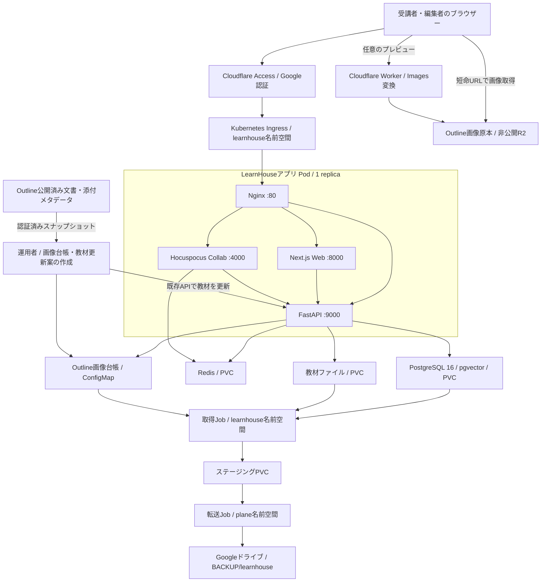

# IMAGEPIT版LearnHouseのアーキテクチャ

[IMAGEPIT版の入口](../../IMAGEPIT.md) / [独自仕様](spec.md)

この文書はリポジトリに記録されたCommunity版PoCの構成を説明します。配備先の稼働状態と任意機能の有効化状態は別途確認が必要です。

## システム全体像

画像URLはLearnHouse APIの閲覧権限検査後に発行します。R2とWorkerへの画像リクエストはブラウザーが送信します。図のOutlineからの入力は、運用者が取得するスナップショットです。

## 技術スタック・コンポーネント

| コンポーネント | 実在パス・根拠 | 技術・役割 |
| --- | --- | --- |
| API | [apps/api/pyproject.toml](../../apps/api/pyproject.toml)、[app.py](../../apps/api/app.py) | Python 3.14.7、FastAPI、SQLModel、SQLAlchemy、Alembic。教材、受講、提出・採点、権限、画像認可 |
| Web | [apps/web/package.json](../../apps/web/package.json) | Next.js 16系、React 19、TypeScript、Tailwind CSS、Tiptap。受講・編集・管理画面 |
| 共同編集 | [apps/collab/package.json](../../apps/collab/package.json)、[サーバー](../../apps/collab/src/index.ts) | Hocuspocus、Yjs、WebSocket。教材とボードの編集同期 |
| 画像変換 | [apps/outline-image-worker/worker.mjs](../../apps/outline-image-worker/worker.mjs)、[設定](../../apps/outline-image-worker/wrangler.toml) | Cloudflare Worker、R2 binding、Images binding。PNG・JPEGをWebPへ変換 |
| 開発・セルフホストCLI | [apps/cli/README.md](../../apps/cli/README.md) | Node.js、Commander。開発環境やDocker環境の管理 |
| 外部アプリ用部品 | [SDK](../../packages/sdk/README.md)、[React](../../packages/react/README.md)、[Vue](../../packages/vue/README.md) | `packages/sdk`、`packages/react`、`packages/vue`にAPIクライアントと教材表示を配置 |
| ドキュメントサイト | [docs/package.json](../package.json)、[読み込み設定](../source.config.ts) | Next.js、Fumadocs。上流の記事は`docs/content/`から取得 |
| 統合イメージ | [Dockerfile](../../Dockerfile)、[起動スクリプト](../../docker/start.sh)、[Nginx設定](../../docker/nginx.conf) | Web・API・CollabをPM2で起動し、Nginxが同一オリジンで振り分け |

Nginxは`/api/auth`をWeb、`/api/v1`と`/content`をAPI、`/collab`を共同編集サーバーへ転送します。サーバー側認証では`LEARNHOUSE_INTERNAL_API_URL`を使って内部APIへ接続します。

## データストア・外部連携

| 保存先・連携先 | 保存内容・用途 | 根拠 |
| --- | --- | --- |
| PostgreSQL 16・pgvector | コース、教材本文、利用者、受講、課題、提出、成績。専用PVCを使用 | [PostgreSQLマニフェスト](../../deploy/k8s/postgres.yaml)、[DB初期化](../../apps/api/src/core/events/database.py) |
| Redis | セッション失効情報などの一時データとキャッシュ。専用PVCを使用 | [Redisマニフェスト](../../deploy/k8s/redis.yaml)、[認証処理](../../apps/api/src/security/auth.py) |
| 教材用PVC | LearnHouseにアップロードした教材ファイル。アプリでは`/app/api/content`にマウント | [workload.yaml](../../deploy/k8s/workload.yaml) |
| Outline画像台帳 | コース・アクティビティ・添付IDとR2オブジェクトの対応。ConfigMapをファイルとしてマウント | [画像サービス](../../apps/api/src/services/media/outline_images.py)、[配備手順](../../deploy/README.md) |
| Outline・R2 | 公開済み文書のMarkdownと添付メタデータを教材移行に使用。画像原本は非公開R2に保持 | [台帳生成](../../deploy/prepare-outline-image-plan.py) |
| Cloudflare Worker | 任意の画像変換経路。認証済みチケットを検査し、原本のETagごとに変換キャッシュを保持 | [Workerの手順](../../apps/outline-image-worker/README.md) |
| Googleドライブ | DBダンプ、教材ファイル、画像台帳の世代別バックアップ | [バックアップ運用](../../deploy/backup/README.md) |

配備設定の教材保存先は`filesystem`です。Outline原本用のR2認証は専用の読み取り権限で用意します。LearnHouseの教材保存先とOutlineの画像保存先は別です。

### 認証とSSOの位置付け

公開URLではCloudflare AccessのGoogle認証を通った後、LearnHouse自身のログインを行います。Accessの認証とLearnHouseのJWT・閲覧権限検査は別々に実施します。[配備手順](../../deploy/README.md)にこのログイン経路が記載されています。

IMAGEPITのworkflowは`LEARNHOUSE_PUBLIC=true`でCommunity版をビルドします。上流の[README](../../README.md)でEnterprise扱いのSSO・複数組織などを、このPoCで利用可能とは扱いません。

## 主要データフロー

### コース配信・学習

ブラウザーは同一オリジンのWebとAPIを通じて、閲覧可能なコースとアクティビティを取得します。APIは認証・権限を検査し、PostgreSQLの教材本文や教材ストレージを返します。レッスン本文はTiptapの構造を使い、IMAGEPIT向けのMarkdownブロックや章リーダーで表示できます。

解答の保存・提出・採点結果と学習進捗はAPI経由でDBに保存します。成績表はDBから受講者と課題・提出状況を集計し、企業・開催回を絞ったPDF・CSVを生成します。詳細は[成績表の仕様](spec.md)を参照してください。

### Outline連携

運用者がOutlineの公開済みリビジョンのMarkdown・添付メタデータと、LearnHouseの対象教材の版・内容を取得します。[台帳生成スクリプト](../../deploy/prepare-outline-image-plan.py)は両者を照合し、R2のHEADでサイズと型を確認して`catalog.json`と`updates.json`を出力します。

運用者は台帳をConfigMapへ登録し、現在の教材との再照合後、既存のアクティビティ更新APIで教材を保存します。更新APIには条件付き書き込みがないため、照合から読み戻しまで対象教材の編集を止めます。自動同期サービスの配備はこの手順に含まれません。

### Outline画像の配信

本文の表示範囲に近づいた画像は、WebからAPIへアクティビティ単位で最大32件ずつ認可を要求します。APIは閲覧権限と台帳を検査し、60秒有効のR2署名付きURL、またはWorker向けの暗号化チケットを返します。

変換を有効にした場合、PNG・JPEGのプレビューを640pxまたは1200px以下のWebPに変換します。Workerはチケットを検査してからキャッシュを参照します。SVGなどの形式と拡大表示には原本を使い、変換失敗時もLearnHouse経由で原本へ戻します。受講者への応答は`private, no-store`です。[Workerの手順](../../apps/outline-image-worker/README.md)と[画像配信の仕様](spec.md#outline画像の認可・配信)に詳細があります。

### ローカルPython実行

対象の演習ではブラウザーから受講者PCのJudge0へコードと公開テストを送ります。待ち受け先は`http://127.0.0.1:2358`です。練習結果をブラウザーに返し、成績に使う正式な提出・採点は既存のLearnHouseの経路で行います。構築手順は[ローカルJudge0](../local-judge0.md)を参照してください。

## 配備・バックアップ構成

### 配備

`imagepit-1.4.5`上で手動実行する[配備workflow](../../.github/workflows/imagepit-deploy.yml)が、同ブランチのHEADまたは指定された40桁のコミットSHAを取得します。指定SHAはフォークのリモートブランチから参照できる必要があります。

Actionsはlinux/amd64のCommunityイメージをビルドし、新規PostgreSQL・Redisでヘルスチェック、ログイン、pgvectorを検証します。非公開Docker Hubへpush後、`learnhouse-release`の`deploy/k8s`とイメージダイジェストを更新します。Argo CDは同ブランチを監視し、mbp16の`learnhouse`名前空間へ同期します。

アプリは1 Podで、Web・API・Collabを同一コンテナー内で動かします。PostgreSQL、Redis、教材にはそれぞれ専用PVCがあります。DBの初期化・マイグレーションはアプリ起動時に実行します。マイグレーション後の切り戻しで旧版が新スキーマに対応しない場合、更新前データの復元も必要です。操作は[配備手順](../../deploy/README.md)を参照してください。

### バックアップ

日次処理は、06:00 JSTの取得Jobと06:30 JSTのDrive転送Jobに分かれます。取得Jobは`learnhouse`名前空間でDB、教材PVC、画像台帳を取得し、ステージングPVCへ書き込みます。`plane`名前空間の転送Jobはステージングを読み取り、所有者限定の`BACKUP/learnhouse`へ保存します。

転送後は全体を読み戻してSHA-256を照合し、成功した世代に`COMPLETE.json`を登録します。保持期間は直近14日で、期限超過時も最新の検証済み2世代を残します。CronJobの初期設定は停止状態で、単発取得・転送・隔離復元を確認してから有効化します。

OutlineのR2原本はOutline側のバックアップで復旧します。Redisの一時データとSecretはLearnHouseのアーカイブに含みません。DBとファイルシステムで共通のトランザクションはないため、整合した復元点が必要な移行前には教材更新を止めます。監視・復旧の詳細は[バックアップ運用](../../deploy/backup/README.md)を参照してください。
